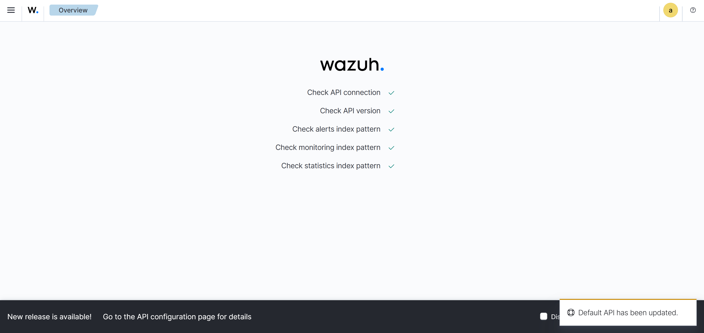
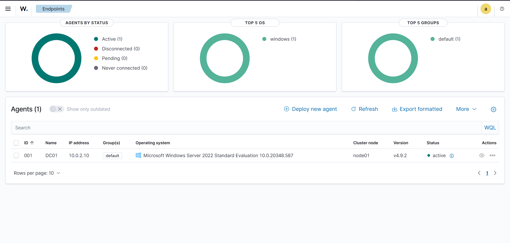
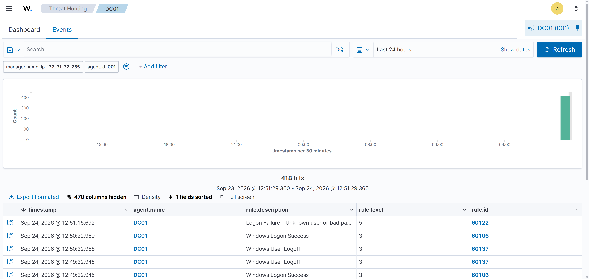
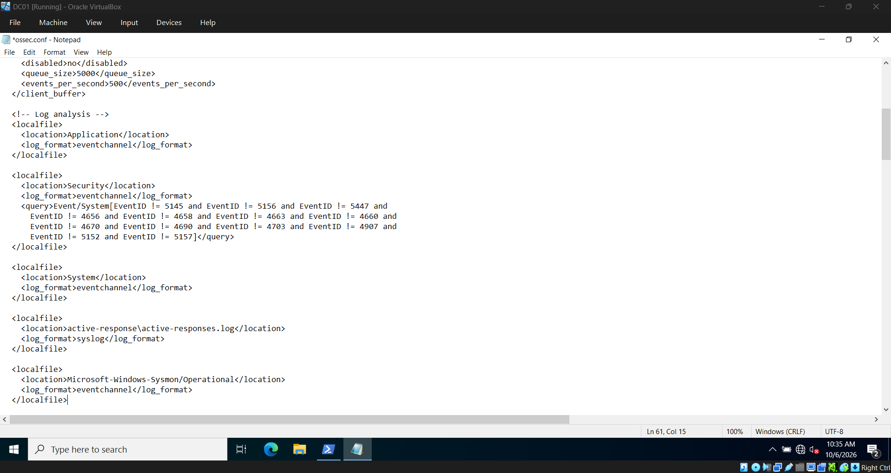

# Detecciones  SIEM en la nube (Semana 2)

Centralización de la telemetría de Active Directory en un SIEM (Wazuh) desplegado en
la nube, con el agente on-prem reportando a través de internet de forma segura.

## Arquitectura: por qué el SIEM vive en la nube

El host local (16 GB RAM) no aguanta DC01 + WKS01 + Wazuh a la vez (Wazuh solo pide
~4 GB y su indexer es pesado). En vez de ahogar la RAM, el SIEM se saca a la nube.
Esto resuelve el límite de memoria y suma un componente cloud real al proyecto.

```
┌────────────────────── INTERNET ────────────────────────┐
|  AWS EC2 (t3.large, Ubuntu 24.04)                      |
│   ┌────────────────────────────────────┐               │
│   │  WAZUH  (manager + indexer + dash) │               │
│   │  Elastic IP fija: 100.60.9.84      │◄─────────┐    │
│   │   Security Group: solo mi IP       │          │    │
│   └────────────────────────────────────┘          │    │
│         ▲ 1) logs cifrados (:1514/:1515) │ 2) dashboard|
└─────────┼─────────────────────────────────────────┼────┘
          │ conexión SALIENTE                       │ (:443)
   ┌──────┼─────────────────────────────────────────┼─────┐
   │  CASA                                          │     │
   │   ┌──┴──────────────────┐        ┌─────────────┴──┐  │
   │   │ DC01 + agente Wazuh │        │Navegador (host)|  │
   │   │ 10.0.2.10           │        └────────────────┘  │
   │   └─────────────────────┘                            │
   └──────────────────────────────────────────────────────┘
```

## Nota sobre el proveedor (Oracle --> AWS)

El plan original era Oracle Cloud (ARM Always Free, 24 GB). Se descartó tras repetidos
errores **"Out of host capacity"** al provisionar la instancia ARM en Monterrey. Se cambeo a **AWS EC2** usando créditos
educativos existentes: capacidad inmediata, sin costo de bolsillo, y AWS pesa
más en vacantes de LATAM. 

## Componentes

| Componente        | Valor                                            |
|-------------------|--------------------------------------------------|
| VM del SIEM       | AWS EC2 `t3.large` (2 vCPU / 8 GB / 30 GB gp3)   |
| SO                | Ubuntu Server 24.04 LTS                          |
| SIEM              | Wazuh 4.9.2 (all-in-one)                         |
| IP pública        | Elastic IP fija `100.60.9.84`                    |
| Agente            | Wazuh Agent 4.9.2 en DC01 (`10.0.2.10`)          |

## Las tres capas de seguridad del canal agente↔nube

| Capa | Qué protege | Cómo |
|------|-------------|------|
| Cifrado AES (1514) | Que nadie lea los logs en tránsito | Nativo del agente Wazuh |
| Enrolamiento con clave (1515) | Que solo mi agente pueda reportar | Token de registro que emite el manager |
| Firewall (Security Group) | Que solo mi tráfico llegue a la VM | Puertos 22/443/1514/1515 restringidos a *My IP* |


## Pasos

1. Lanzar instancia EC2: Ubuntu 24.04, `t3.large`, 30 GiB, par de llaves `.pem`.
   Security Group inicial: solo SSH (22) desde *My IP*.

2. Conectarse por SSH desde WSL (permisos de la llave primero):

   ```bash
   chmod 600 ~/wazuh-AWS-colibripay.pem
   ssh -i ~/wazuh-AWS-colibripay.pem ubuntu@<ip>
   ```

3. Actualizar e instalar Wazuh (all-in-one):

   ```bash
   sudo apt update && sudo apt upgrade -y
   curl -sO https://packages.wazuh.com/4.9/wazuh-install.sh && sudo bash ./wazuh-install.sh -a
   ```

   > El instalador imprime al final el usuario `admin` y una contraseña generada.
   > Las guardamos en un lugar seguro

4. Verificar que el manager está vivo:

   ```bash
   sudo systemctl status wazuh-manager --no-pager   # deberia aparece: active (running)
   ```

5. Asignar una **Elastic IP** y asociarla a la instancia. Fija la IP pública para que
   no cambie al apagar/prender .

6. Abrir puertos en el Security Group, todos restringidos a *My IP*:
   `443` (dashboard), `1514` (eventos del agente), `1515` (enrolamiento del agente).

7. Entrar al dashboard: `https://<ip>` (certificado autofirmado -> continuar).
   Health-check con los 5 checks en verde.
   

8. Instalar el agente en DC01 (PowerShell como administrador). El comando lo genera el
   propio dashboard con la IP del manager embebida:

   ```powershell
   Invoke-WebRequest -Uri https://packages.wazuh.com/4.x/windows/wazuh-agent-4.9.2-1.msi -OutFile $env:tmp\wazuh-agent; msiexec.exe /i $env:tmp\wazuh-agent /q WAZUH_MANAGER='<ip>' WAZUH_AGENT_NAME='DC01'
   NET START WazuhSvc
   ```

9. Verificar que DC01 aparece **Active** en el dashboard (Server management -->
   Endpoints Summary).
   

   > Si el agente no aparece, tal vez es que faltan abrir los puertos
   > **1514 y 1515** en el Security Group (paso 6). Sin el 1515 el agente nunca
   > completa el enrolamiento.

## Verificación  la detección de punta a punta

Prueba de que el pipeline **funciona**, no solo que se instaló: provocar un login
fallido en DC01 y confirmar que la alerta llega al SIEM en la nube.

```powershell
runas /user:corp\mtorres cmd     # contraseña incorrecta a propósito
```

En el dashboard (Threat Hunting --> DC01 --> Events), aparece la alerta:

| Campo | Valor |
|-------|-------|
| rule.description | Logon Failure - Unknown user or bad password |
| rule.id | 60122 (corresponde al Event ID **4625** de Windows) |
| rule.level | 5 (elevado sobre los logins normales, nivel 3) |
| agent.name | DC01 |


La cadena completa que esto valida: GPO de auditoría (Semana 1) --> Windows registra el
4625 --> el agente lo captura --> viaja cifrado --> llega a Wazuh
en AWS --> se correlaciona con la regla 60122 --> aparece en el dashboard en tiempo real.


# Sysmon  telemetría profunda

La auditoría nativa de Windows dice *"se creó un proceso"*. Sysmon dice *qué
proceso, con qué argumentos, lanzado por quién, con qué hash, desde dónde*. Van a ser los datos para cazar los ataques de la
Semana 3.

10. Instalar Sysmon en DC01 con una config curada (PowerShell como administrador):

    ```powershell
    mkdir C:\sysmon; cd C:\sysmon

    Invoke-WebRequest -Uri https://download.sysinternals.com/files/Sysmon.zip -OutFile Sysmon.zip

    Expand-Archive Sysmon.zip -DestinationPath .

    Invoke-WebRequest -Uri https://raw.githubusercontent.com/SwiftOnSecurity/sysmon-config/master/sysmonconfig-export.xml -OutFile sysmonconfig.xml

    .\Sysmon64.exe -accepteula -i sysmonconfig.xml

    Get-Service Sysmon64   # Deberia decir Running
    ```

    > Se usa la config de **SwiftOnSecurity** (referencia de la comunidad) en vez de
    > la default: filtra el ruido de procesos benignos (`calc.exe`, etc.) y captura
    > solo lo que tiene valor de detección. Instalar Sysmon sin config curada lo
    > vuelve inservible por exceso de ruido.

11. Decirle al agente Wazuh que lea el log de Sysmon. Editar
    `C:\Program Files (x86)\ossec-agent\ossec.conf` y agregar, adentro del bloque
    `</ossec_config>`:

    ```xml
      </ossec_config>
      .
      .
      .
      <localfile>
         <location>Microsoft-Windows-Sysmon/Operational</location>
         <log_format>eventchannel</log_format>
      </localfile>
      .
      .
      .
      </ossec_config>
    ```
      
    Reiniciar el agente:

    ```powershell
    Restart-Service WazuhSvc
    ```

12. Verificar que la telemetría de Sysmon llega. En Threat Intelligence --> Threat Hunting -->
    Events, filtrar:

    ```
    data.win.system.providerName: "Microsoft-Windows-Sysmon"
    ```

    El volumen de eventos salta de ~100 a ~500+ por día. Un `whoami /all` generó
    detecciones como `net.exe account discovery` (T1087) y un PowerShell generó una
    alerta **nivel 15** (ver triaje abajo).

    > Prueba de que el filtrado funciona: `calc.exe` **no** aparece (la config lo
    > ignora a propósito). Un SIEM que registra todo es un SIEM inútil; el valor está
    > en registrar lo que importa.

## Primer triaje  falso positivo nivel 15

Un `powershell.exe -Command "whoami"` disparó la regla **92213** ("Executable file
dropped in folder commonly used by malware"), **nivel 15 (crítico)**. En vez de
confiar en el nivel, se investigó el evento.

La regla se dispara con **Sysmon Event ID 11 (File Create)** cuando se crea un
ejecutable/script en `AppData\Local\Temp`. El evento reveló:

| Campo | Valor |
|-------|-------|
| targetFilename | `...\AppData\Local\Temp\__PSScriptPolicyTest_0statd2z.wqf.ps1` |
| image (proceso) | `...\WindowsPowerShell\v1.0\powershell.exe` |
| user | `CORP\Administrator` (yo) |

El archivo `__PSScriptPolicyTest_*.ps1` lo crea **el propio PowerShell** al verificar
su política de ejecución. Proceso legítimo + usuario legítimo + archivo conocido de
Windows = **falso positivo**.


> **Lección.** Una regla puede ser técnicamente correcta y aun así generar ruido. Un
> nivel 15 no es un ataque por decreto; el analista correlaciona contexto (proceso
> padre, usuario, archivo) antes de actuar. Confiar ciegamente en la severidad lleva
> a *fatiga de alertas*. El triaje  recibir, investigar, clasificar  es el núcleo
> del trabajo de un SOC.

